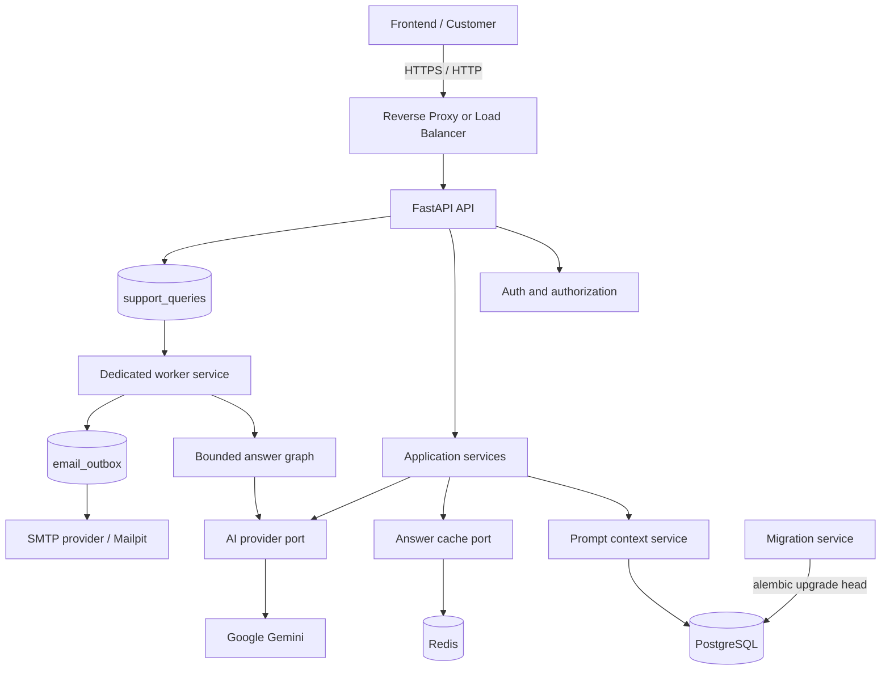
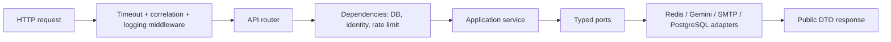
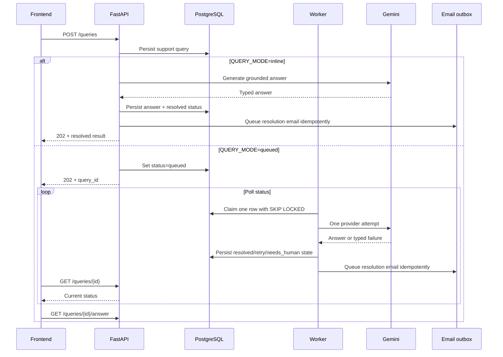
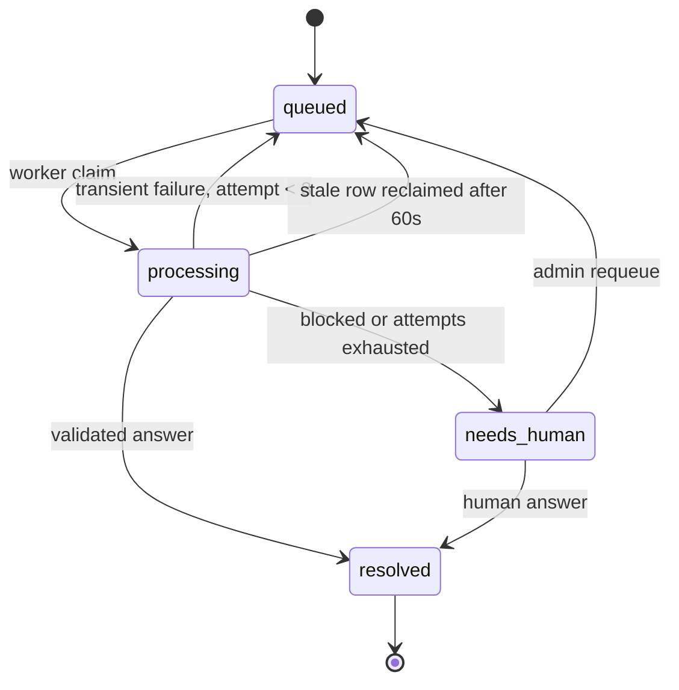

# SupportIq

SupportIq is an AI-powered customer-support backend built with FastAPI, PostgreSQL, Redis, and Google Gemini. It grounds answers in approved knowledge and verified order facts, supports inline and queued processing, and escalates unsafe or unresolved answers to human support.

> **Current status:** staging-ready local deployment. The Docker Compose stack is operational, but production still needs a real email provider, HTTPS/load balancing, worker health monitoring, backups, and observability.

## Contents

1. [Capabilities](#capabilities)
2. [Architecture](#architecture)
3. [Application layer and abstractions](#application-layer-and-abstractions)
4. [Folder structure](#folder-structure)
5. [Query lifecycle](#query-lifecycle)
6. [Queue and retry behavior](#queue-and-retry-behavior)
7. [Email delivery](#email-delivery)
8. [Redis, caching, and rate limiting](#redis-caching-and-rate-limiting)
9. [Authentication and security](#authentication-and-security)
10. [API reference](#api-reference)
11. [Configuration](#configuration)
12. [Running locally](#running-locally)
13. [Testing](#testing)
14. [Deployment status and remaining work](#deployment-status-and-remaining-work)

## Capabilities

- FastAPI HTTP API with Pydantic request/response validation.
- Inline AI answering or durable PostgreSQL-backed queued answering.
- Dedicated worker service with `FOR UPDATE SKIP LOCKED` queue claims.
- AI answer validation, grounding checks, retry backoff, and human handoff.
- Google Gemini integration with typed provider errors, timeout limits, and retry handling.
- Redis-backed response caching and stampede-prevention locks.
- Redis-backed sliding-window rate limiting with fail-closed behavior when Redis is configured but unavailable.
- JWT access tokens and opaque, hashed, rotating refresh tokens.
- Admin-key protection for operational and write endpoints.
- Idempotent email outbox with database leases, retry recovery, and deterministic `Message-ID` values.
- PostgreSQL migrations managed by Alembic in a separate migration container.
- Structured JSON logging, correlation IDs, security headers, and request timeouts.
- LangGraph-based bounded AI workflow with no database or email side effects inside the graph.

## Architecture



The API process does not run the worker loop. Docker Compose starts the migration service first, then starts the API and worker services against the same PostgreSQL database.

### HTTP request composition



## Application layer and abstractions

The application layer hides infrastructure details from routes and workers.

| Component | Responsibility |
|---|---|
| `AIAnswerer` port | Defines the provider contract without coupling workflows to Gemini. |
| `AnswerCachePort` | Defines cache and locking behavior without exposing Redis operations. |
| `AnswerGenerationService` | Owns cache keys, cache reads/writes, stampede locks, and answer generation. |
| `WorkerTask` protocol | Allows the worker runtime to run replaceable task implementations. |
| `run_support_graph` | Encapsulates generate → plan → validate → resolve/handoff behavior. |
| DTO schemas | Keep public API contracts separate from SQLAlchemy models. |

The inline query route and background worker use the same [AnswerGenerationService](app/application/services.py). This avoids duplicated cache/provider logic and makes fake providers and caches easy to use in tests.

## Folder structure

```text
supportiq/
├── alembic/
│   ├── env.py
│   └── versions/                    # Database migrations
├── app/
│   ├── main.py                      # FastAPI composition root
│   ├── api/v1/                      # HTTP routers and public endpoints
│   │   ├── auth.py
│   │   ├── health.py
│   │   ├── knowledge.py
│   │   ├── orders.py
│   │   └── queries.py
│   ├── application/                 # Use cases and stable ports
│   │   ├── ports.py
│   │   └── services.py
│   ├── core/                        # Database, security, cache, middleware
│   │   ├── cache.py
│   │   ├── database.py
│   │   ├── deps.py
│   │   ├── health.py
│   │   ├── logging.py
│   │   ├── middleware.py
│   │   └── security.py
│   ├── models/tables.py             # SQLAlchemy persistence model
│   ├── schemas/dto.py               # Pydantic API contracts
│   └── services/
│       ├── agent_graph.py           # Bounded AI workflow
│       ├── ai_service.py            # Gemini adapter and typed errors
│       ├── mail.py                  # Durable email outbox and SMTP adapter
│       ├── prompt_context.py        # Knowledge and order grounding
│       └── worker.py                # Queue claim, retry, reaper, runtime
├── tests/                           # Offline unit and integration tests
├── Dockerfile
├── docker-compose.yml
├── requirements.txt
└── README.md
```

## Query lifecycle



## Queue and retry behavior



- Queue claims use PostgreSQL row locking and `SKIP LOCKED`.
- Each worker attempt makes one Gemini call.
- Retry backoff is 2, 4, and 8 minutes.
- Maximum AI attempts per query: 3.
- Blocked or unsafe model output goes directly to human support.
- A stale `processing` row is reclaimed after 60 seconds.
- The worker heartbeat is stored in Redis when available and exposed through admin queue statistics.

## Email delivery

The `email_outbox` table is the durable source of truth for outbound resolution mail.

- `idempotency_key` prevents duplicate queue rows.
- `sending` rows have `locked_at` and `locked_by` delivery leases.
- Workers claim rows with a short database transaction before calling SMTP.
- Stale leases are recoverable after the delivery lease expires.
- A deterministic `Message-ID` is generated from the idempotency key.
- Raw SMTP is still technically at-least-once if a process crashes after SMTP accepts a message but before the database is updated. A provider with idempotency-key support is required for stronger exactly-once behavior.

Mailpit is used only for local development. Production must use a real transactional email provider with TLS, credentials, bounce monitoring, and provider-side idempotency support.

## Redis, caching, and rate limiting

| Feature | Implementation |
|---|---|
| Distributed rate limiting | Redis sliding window, 30 protected requests per client per minute |
| Rate-limit key privacy | HMAC digest; raw client IP is not stored in Redis |
| AI response cache | Redis, 600-second default TTL |
| Cache stampede lock | Redis `SET NX` lock with configurable TTL |
| Worker heartbeat | Redis hash with 30-second expiry |
| Redis failure behavior | Cache degrades safely; configured rate-limit failures return `503` rather than silently removing protection |
| Local fallback | In-memory rate limiter only when `REDIS_URL` is not configured |

## Authentication and security

- Access tokens use HS256 with a configured secret and a 15-minute lifetime.
- Refresh tokens are opaque random values; only SHA-256 hashes are stored.
- Refresh-token rotation detects reuse and revokes the entire token family.
- Admin endpoints require `X-Admin-Key` and fail closed when no key is configured.
- Customer data access is scoped to the verified JWT email in production.
- Passwords use PBKDF2-HMAC-SHA256 with 210,000 iterations and per-user salts.
- Request IDs, structured logging, secret redaction, security headers, and a configurable request timeout are enabled.
- API and worker containers run as a non-root user.

Production still needs HTTPS at a reverse proxy, secret-manager integration, secure `HttpOnly` refresh-token cookies with CSRF protection, admin rate limiting, dependency/image scanning, and tested backup restoration.

## API reference

### Queries

| Method | Endpoint | Purpose | Authentication |
|---|---|---|---|
| POST | `/queries` | Submit a support query; returns `202` | JWT required in production |
| GET | `/queries/{query_id}` | Read query status | JWT required in production |
| GET | `/queries/{query_id}/answer` | Read the latest answer | JWT required in production |
| PATCH | `/queries/{query_id}/feedback` | Submit a 1–5 rating and comment | JWT required in production |
| PATCH | `/queries/{query_id}` | Admin status transition | Admin key |
| PATCH | `/queries/{query_id}/answer` | Submit a human answer | Admin key |
| POST | `/queries/{query_id}/requeue` | Requeue processing/human-review item | Admin key |
| GET | `/admin/needs-human` | List human-support items | Admin key |

### Authentication

| Method | Endpoint | Purpose |
|---|---|---|
| POST | `/auth/login` | Issue access and refresh tokens |
| POST | `/auth/refresh` | Rotate a refresh token |
| POST | `/auth/logout` | Revoke a refresh-token family member |

### Operations and data

| Method | Endpoint | Purpose |
|---|---|---|
| GET | `/healthz` | Database and Gemini health probe |
| GET | `/admin/queue-stats` | Queue counts and worker heartbeat; admin key |
| POST | `/orders` | Create order and events; admin key |
| GET | `/orders/{order_number}` | Read authenticated order tracking |
| POST | `/knowledge` | Create a draft knowledge answer; admin key |

The frontend must support `queued`, `processing`, `resolved`, `needs_human`, and `closed` states. In queued mode, it should poll `/queries/{query_id}` and request `/queries/{query_id}/answer` after resolution.

## Configuration

Copy `.env.example` to `.env` and replace every placeholder with a secure value.

| Variable | Default | Required | Description |
|---|---:|:---:|---|
| `DATABASE_URL` | — | Yes | SQLAlchemy PostgreSQL URL |
| `POSTGRES_USER` | `supportiq` | No | Compose database user |
| `POSTGRES_PASSWORD` | — | Yes for Compose | Compose database password |
| `POSTGRES_DB` | `supportiq` | No | Compose database name |
| `GEMINI_API_KEY` | — | Yes | Google Gemini credential |
| `JWT_SECRET_KEY` | — | Yes | Access-token signing secret |
| `ADMIN_API_KEY` | — | No | Admin key; absent means fail closed |
| `CACHE_KEY_SECRET` | — | Yes with Redis | HMAC secret for cache/rate-limit keys |
| `REDIS_URL` | — | No locally | Redis URL for distributed cache and limiting |
| `AI_CACHE_TTL_SECONDS` | `600` | No | Successful answer cache TTL |
| `AI_CACHE_LOCK_SECONDS` | `15` | No | Cache stampede lock TTL |
| `QUERY_MODE` | `inline` | No | `inline` or `queued`; Compose uses `queued` |
| `REFRESH_TOKEN_MINUTES` | `720` | No | Absolute refresh-token lifetime |
| `EMAIL_DELIVERY_LEASE_SECONDS` | `120` | No | Email outbox lease duration |
| `WORKER_ID` | hostname | No | Must be unique when scaling workers |
| `SMTP_HOST` | `localhost` | No | SMTP host; Compose uses Mailpit |
| `SMTP_PORT` | `1025` | No | SMTP port |
| `SMTP_USER` | empty | No | SMTP username |
| `SMTP_PASSWORD` | empty | No | SMTP password |
| `MAIL_FROM` | `support@supportiq.local` | No | Sender address |
| `MAIL_FROM_NAME` | `SupportIq` | No | Sender display name |

## Running locally

### Docker Compose

Docker Compose starts PostgreSQL, Redis, Mailpit, the Alembic migration service, the API, and the dedicated worker.

```powershell
docker compose up --build
```

Endpoints:

- API: `http://127.0.0.1:8765`
- Health: `http://127.0.0.1:8765/healthz`
- Mailpit UI: `http://127.0.0.1:8025`
- SMTP: `127.0.0.1:1025`

Stop services while preserving volumes and database data:

```powershell
docker compose stop
```

Start them again:

```powershell
docker compose start
```

Do not use `docker compose down -v` unless intentionally deleting the local database and Redis volumes.

### Local Python process

```powershell
python -m venv .venv
.\.venv\Scripts\Activate.ps1
pip install -r requirements.txt
uvicorn app.main:app --reload
```

For queued processing in a separate terminal:

```powershell
$env:QUERY_MODE = "queued"
python -m app.services.worker
```

## Testing

Tests are designed to run offline with SQLite and mocked AI behavior.

```powershell
python -m pytest -q
```

The latest verified run passed 126 tests. Coverage includes API behavior, authentication and refresh-token rotation, privacy, queue claims and reaping, worker lifecycle substitution, AI graph validation, email outbox behavior, application-service ports, and health endpoints.

Static diagnostics and `git diff --check` should also be run before committing.

## Deployment status and remaining work

### Implemented

- Dockerfile with Python 3.12 slim base and non-root runtime user.
- Separate migration, API, and worker services.
- PostgreSQL health-gated migrations.
- Redis-backed distributed rate limiting and answer caching.
- Durable worker queue and email outbox.
- Alembic schema migrations through the current email-delivery lease migration.
- Application ports and service layer for answer generation.
- Structured logs, correlation IDs, timeout middleware, and security headers.

### Required before production

- Replace Mailpit with a production transactional email provider.
- Add HTTPS reverse proxy or cloud load balancer.
- Add CORS configuration for the deployed frontend origin.
- Add separate liveness and readiness probes.
- Enable worker healthchecks and unique worker IDs when scaling.
- Add PostgreSQL backups and a tested restore procedure.
- Add metrics, centralized logs, queue alerts, and provider failure alerts.
- Move secrets to a managed secret store.
- Add frontend integration tests and normalize error responses.
- Protect refresh-token rotation with a database row lock for concurrent refresh requests.
- Recalculate connection-pool limits when running multiple API replicas.

## License

Private / internal use.

---

*Last updated: 2026-11-03*
